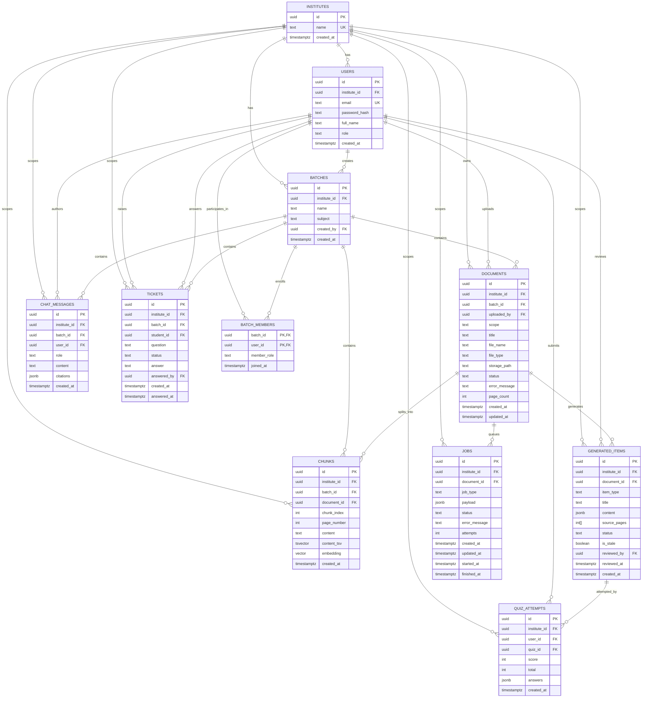

# Cognify Entity-Relationship Diagram & Schema Architecture

This document provides the complete Mermaid ER diagram for all 11 PostgreSQL tables in Cognify, accompanied by normalization notes and architectural rationale.

---

## 1. Mermaid Entity-Relationship Diagram



---

## 2. Normalization Analysis

### First Normal Form (1NF)
- Every table has a primary key (`id` or composite `(batch_id, user_id)` in `batch_members`).
- Each column contains atomic values, with standard structured types (`JSONB`, `INT[]`, `VECTOR`, `TSVECTOR`) used deliberately for complex schemas (e.g., hierarchical notes sections, multiple choice questions, array of citation maps).
- No repeating groups or comma-separated lists.

### Second Normal Form (2NF)
- All non-key attributes are fully functionally dependent on the entire primary key.
- In `batch_members`, the composite primary key `(batch_id, user_id)` uniquely identifies membership, and `member_role` / `joined_at` depend on the whole composite key.

### Third Normal Form (3NF)
- Non-key attributes depend only on the primary key, with zero transitive dependencies across core relational entities (`institutes`, `users`, `batches`, `batch_members`, `tickets`).
- Foreign keys strictly enforce referential integrity (`ON DELETE CASCADE` on child document assets, `ON DELETE SET NULL` on author/reviewer references).

---

## 3. Deliberate Denormalization: `chunks` Table

The `chunks` table intentionally includes both `institute_id` and `batch_id` alongside `document_id`.

### Engineering Rationale:
1. **High-Performance HNSW Vector Search**:
   In PostgreSQL with pgvector, vector queries use an Approximate Nearest Neighbor (ANN) index (e.g., HNSW with `vector_cosine_ops`). Filtering vector embeddings across millions of chunks requires pre-filtering or tight index scans.
   By storing `institute_id` and `batch_id` directly on the `chunks` table:
   ```sql
   SELECT c.id, 1 - (c.embedding <=> $1) AS similarity
   FROM chunks c
   WHERE c.institute_id = $2 AND c.batch_id = $3
   ORDER BY c.embedding <=> $1 ASC
   LIMIT 20;
   ```
   PostgreSQL executes the vector distance search strictly within the partition of chunks belonging to that specific tenant and batch, without requiring a costly runtime `JOIN documents d ON d.id = c.document_id`.

2. **Security & Strict Multi-Tenancy**:
   If `institute_id` were only on `documents`, a query bug or omission in a join could risk scanning chunks across tenant boundaries. Storing `institute_id` directly on `chunks` guarantees that every vector, full-text, and metadata search enforces tenant isolation at the leaf storage level.

3. **Hybrid Search (RRF) Efficiency**:
   Reciprocal Rank Fusion fusions both the HNSW vector search and PostgreSQL Full-Text Search (`tsvector @@ websearch_to_tsquery(...)`). Both search engines query the single `chunks` table with indexed predicates `WHERE institute_id = $1 AND batch_id = $2`, allowing index-only and bitmap index scans.
